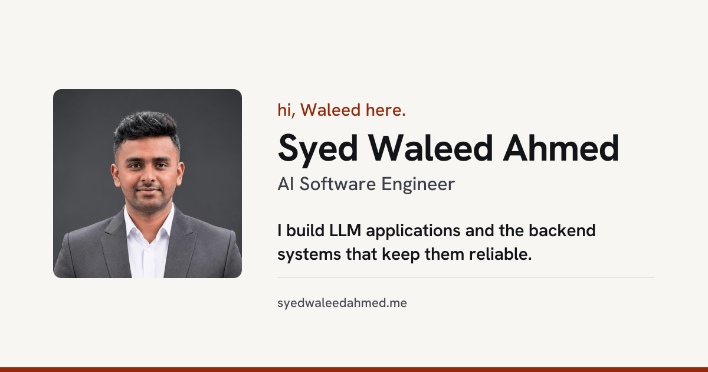

# Syed Waleed Ahmed: portfolio

[](https://github.com/syed-waleed-ahmed/Portfolio/actions/workflows/ci.yml)
[](LICENSE)

The source of [syedwaleedahmed.me](https://syedwaleedahmed.me/): who I am, what I have built, and a case study for
each project with its architecture, how it was evaluated, and what it does not do yet.

[](https://syedwaleedahmed.me/)

## The case studies

| Project | What it shows |
|---|---|
| [RemindrAI](https://syedwaleedahmed.me/work/remindrai/) | My MSc thesis: a multi-tenant reminder service AI assistants embed, with at-most-once delivery, four-depth tenant isolation and a 92-case agent evaluation |
| [Self-Correcting RAG](https://syedwaleedahmed.me/work/self-correcting-rag/) | Hybrid retrieval with a relevance filter and a grounding check, and an evaluation that found the correction loop did not pay off |
| [LLM-as-Judge](https://syedwaleedahmed.me/work/llm-as-judge/) | An evaluation library on PyPI, and why it is not yet a validated measurement |
| [FastAPI Niche Assistant](https://syedwaleedahmed.me/work/fastapi-niche-assistant/) | A LoRA fine-tune served on CPU, with a paired comparison against its own base model |
| [AI Workflow Assistant](https://syedwaleedahmed.me/work/ai-workflow-assistant/) | A spreadsheet analyst where no model-written code runs and every figure is traced |
| [Multi-Agent Research Team](https://syedwaleedahmed.me/work/multi-agent-research-team/) | A three-stage agent pipeline built to survive free-tier rate limits |

## How the site works

```text
Browser ──> Cloudflare: prerendered pages from frontend/dist, with strict security headers
   └── POST /api/contact ──> Worker ──> Resend ──> inbox
                               └── rate limit: one Durable Object per client
```

- **Prerendered, then hydrated.** Every page, including each case study, is an HTML file written at build time
  from React components, so it reads fully without JavaScript. The browser hydrates the same tree.
- **Facts stated once.** Experience, projects and skills are typed data in `frontend/src/content/`; the pages, the
  structured data, the sitemap and the command palette all read them.
- **The contact form posts to the site's own origin.** A Cloudflare Worker validates it with the same module the
  form uses, rate-limits per client with a Durable Object, and sends it through Resend. It works without
  JavaScript too.
- **No analytics, no cookies, no third-party requests,** and a Content Security Policy with no inline code.

The reasons, the trade-offs and the alternatives are in [docs/architecture.md](docs/architecture.md).

| | |
|---|---|
| Frontend | React 19, TypeScript (strict), Vite 8, plain CSS in cascade layers, `cmdk` for the palette |
| API | A Cloudflare Worker with a SQLite-backed Durable Object, Resend's REST API |
| Quality | ESLint, `tsc`, Node's test runner, Playwright with axe-core, size budgets |
| Delivery | GitHub Actions, Cloudflare Workers, Dependabot, gitleaks |

## Running it

Node 24 (see `.nvmrc`).

```bash
git clone https://github.com/syed-waleed-ahmed/Portfolio.git
cd Portfolio
npm run install:all
npm run dev          # the site on http://localhost:5173
npm run dev:api      # optional: the contact API on :8787 (wrangler dev)
```

| Command | |
|---|---|
| `npm run lint` and `npm run typecheck` | ESLint and TypeScript |
| `npm test` | Content, routing and Worker tests, then the repository invariants |
| `npm run build` | The checks above, then build and prerender into `frontend/dist` |
| `npm run test:e2e` | Browser tests against the build, under its production headers |

More in [docs/development.md](docs/development.md).

## Quality checks

On every pull request and push to `main`, CI runs lint, the type check, the unit and Worker tests, invariants (7:1
text contrast in both themes, a strict CSP, the deploy configuration), a build, size budgets, `npm audit`, the
browser suite in Chromium, Firefox and WebKit (axe in light and dark on every page, layout from 320 to 2560px, the
form, the palette, print and forced colours) and gitleaks over the full history. The site deploys only after all of
it passes, and each deploy is checked against the live origin. Details in [docs/deployment.md](docs/deployment.md).

## Documentation

| | |
|---|---|
| [Architecture](docs/architecture.md) | Rendering, content, the contact API, security, decisions |
| [Development](docs/development.md) | Setup, editing content, tests, troubleshooting |
| [Deployment](docs/deployment.md) | The deploy pipeline, secrets, domain, releases |
| [Design](docs/design.md) | Colour, type, layout, accessibility |
| [Changelog](CHANGELOG.md) | Releases |

## How this was built

I write much of my code with AI coding assistants, mostly Claude; commits written with one carry a
`Co-Authored-By` line. The design, the evaluation claims and what goes on the site are mine to answer for.

## Contributing and security

Bug reports and accessibility or performance fixes are welcome as issues or pull requests; the content is personal,
so content changes are not. Report a vulnerability privately, as [SECURITY.md](SECURITY.md) describes.

## License

MIT, see [LICENSE](LICENSE). You are welcome to adapt it for your own site; replace the content in
`frontend/src/content/`, the case studies in `frontend/src/case-studies/` and the images in `frontend/public/`.
